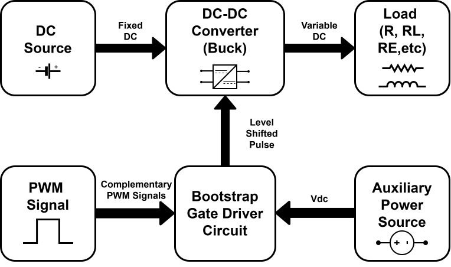

# Design of a Bootstrap Gate Driver Circuit for Buck Converter Using LTspice

**Project Code:** 26EE472  
**Academic Year:** 2026–2027 (B.Tech Final Year, Semester 07)  
**Institution:** Shri Guru Gobind Singhji Institute of Engineering and Technology, Vishnupuri, Nanded - 431606 (M.S.)

---

## 📌 Overview

Power electronic converters are widely used for efficient energy conversion in modern electrical systems. High-speed switching devices in these converters require effective gate-driving techniques to ensure reliable operation and minimize switching losses.

This project focuses on the **design, simulation, and performance analysis of a bootstrap gate driver circuit for a synchronous buck converter using LTspice**. A bootstrap gate driver provides the required gate-to-source voltage for switching a high-side N-channel MOSFET (`S1`) using a bootstrap capacitor (`C_boot`) and a bootstrap diode (`D_boot`). This creates a floating gate-drive supply without requiring a bulky or expensive isolated power source, offering a compact and cost-effective solution.

---

## 🎯 Objectives

- To understand the working principle of a synchronous DC-DC buck converter.
- To study the charging and discharging behavior of the bootstrap gate driver circuit.
- To analyze high-side MOSFET gate driving using bootstrap level-shifting technology.
- To evaluate switching performance, voltage ripple, and overall converter operation.
- To validate the circuit design through LTspice simulations under varying operating conditions.

---

## 🏗️ System Architecture

### 1. Block Diagram Overview



**Figure 1:** Block diagram of the Power Stage and Control & Driving Stage.

The system consists of two primary paths: the **Power Stage** and the **Control & Driving Stage**. The Power Stage handles the main power flow, while the Control & Driving Stage generates the control signals required to operate the power components.

### 2. Circuit Description

The circuit topology implemented in LTspice includes the following components and functional stages:

- **Main Power Supply (`Vs`):** Provides the fixed input DC voltage to the buck converter.
- **Auxiliary Power Supply (`VDD`):** Supplies low-voltage DC power to the gate driver IC and charges the bootstrap network.
- **Gate Driver IC:** Accepts logic-level inputs (`PWM_HS_IN` at pin `HI` and `PWM_LS_IN` at pin `LI`) and generates gate-drive signals (`HO` for the high-side MOSFET and `LO` for the low-side MOSFET).
- **Bootstrap Network:** Consists of the bootstrap diode (`D_boot`), current-limiting resistor (`R_boot`), and bootstrap capacitor (`C_boot`) connected between pins `HB` and `HS`. When the low-side switch (`S2`) conducts, the `HS` node is pulled close to ground, allowing `C_boot` to charge through `D_boot`. When `S2` turns off and the high-side switch (`S1`) turns on, the stored charge in `C_boot` provides the floating supply required to drive the high-side MOSFET.
- **Switching and Gate Conditioning Stage:**
  - **High-Side MOSFET (`S1`):** Driven through gate resistor `R1`, with pull-down resistor `R2`.
  - **Low-Side MOSFET (`S2`):** Driven through gate resistor `R3`, with pull-down resistor `R4`.
- **LC Filter and Load Stage:** Consists of the filter inductor (`L`), output capacitor (`C`), and load resistor (`R`). The LC filter smooths the switching waveform to produce the output voltage (`Vo`) across the load.

---

## 🛠️ Software & Tools Required

- **Simulator:** [LTspice](https://www.analog.com/en/resources/design-tools-and-calculators/ltspice-simulator.html) by Analog Devices.
- **Key Components Modeled:**
  - Half-bridge / high-low-side gate driver IC
  - Power MOSFETs (`S1`, `S2`)
  - Fast-recovery / Schottky bootstrap diode (`D_boot`)
  - Passive filtering and gate-conditioning components (`L`, `C`, `R`, `C_boot`, `R_boot`, `R1`–`R4`)

---


# LTspice Simulation Guide: Bootstrap Gate Driver Circuit

## 1. Overview
This project simulates a bootstrap gate driver circuit and buck converter using LTspice. It analyzes gate-drive voltage, bootstrap capacitor voltage, switching-node voltage, inductor current, and output voltage.

## 2. Download and Install LTspice
Download LTspice from the official Analog Devices website:

https://www.analog.com/en/resources/design-tools-and-calculators/ltspice-simulator.html

1. Download the Windows installer.
2. Run the installer and complete the installation.
3. Launch LTspice.

## 3. Open the Simulation File
1. Save the provided `.asc` schematic file to your computer.
2. Open LTspice.
3. Select **File → Open**.
4. Browse to the project folder.
5. Open .

## 4. Configure Simulation Parameters

| Parameter | LTspice Name | Value |
|---|---|---:|
| Input DC voltage | Vs | 120 V |
| Gate-driver supply | Vcc | 12 V |
| PWM amplitude | Vpulse_1, Vpulse_2 | 0–5 V |
| Switching frequency | PWM sources | 10 kHz |
| PWM period | PWM sources | 100 µs |
| Pulse width | PWM sources | 49 µs |
| Pulse delay 1 | Vpulse_1 | 1 µs |
| Pulse delay 2 | Vpulse_2 | 51 µs |
| Rise time | PWM sources | 75 ns |
| Fall time | PWM sources | 45 ns |
| Bootstrap capacitor | Cboot | 1 µF |
| Bootstrap resistor | Rboot | 1 Ω |
| Bootstrap diode | Dboot | 1N5819 |
| High-side MOSFET | S1 | IRF530 |
| Low-side MOSFET | S2 | IRF530 |
| Gate resistors | R1, R2 | 15 Ω |
| Inductor | L | 8.33 mH |
| Output capacitor | C | 5 µF |
| Output load | R_load | 50 Ω |
| Input capacitor | Cin | 10 µF |
| Simulation stop time | `.tran` | 10 ms |
| Maximum timestep | `.tran` | 100 ns (recommended) |

**Note:** Verify the component values and model names against the actual schematic before simulation.

## 5. Verify PWM Pulse Sources

The pulse-source expressions are:

```spice
PULSE(0 5 1u 75n 45n 49u 100u)
PULSE(0 5 51u 75n 45n 49u 100u)
```

The switching frequency is calculated as:

\[
f_s = \frac{1}{T_s}
\]

\[
f_s = \frac{1}{100\,\mu s} = 10\,kHz
\]

## 6. Configure Transient Analysis

Set the transient-analysis command to:

```spice
.tran 0 10m 0 100n
```

1. Locate the transient directive in the schematic.
2. Right-click it.
3. Set the stop time to `10m`.
4. Set the maximum timestep to `100n`.
5. Apply the changes.

## 7. Run the Simulation

1. Click the **Run** button.
2. Wait for the transient analysis to finish.
3. Return to the schematic window.
4. Click circuit nodes to plot voltage waveforms.
5. Click the inductor to plot its current.
6. Use **Plot Settings → Add Trace** to enter voltage-difference expressions.

## 8. Observe and Analyze Waveforms

| Waveform | LTspice Expression | Purpose |
|---|---|---|
| High-side gate-to-source voltage | `V(HO)-V(HS)` | Evaluates high-side MOSFET gate drive |
| Bootstrap capacitor voltage | `V(HB)-V(HS)` | Checks bootstrap supply voltage |
| Switching-node voltage | `V(HS)` | Observes switching transitions |
| Inductor current | `I(L)` | Evaluates current ripple |
| Output voltage | `V(out)` | Checks filtered DC output |

Replace `HO`, `HS`, `HB`, and `out` with the actual node labels in your schematic if they differ.

## 9. Expected Buck Converter Output

For an ideal buck converter operating in continuous conduction mode:

\[
V_o \approx D V_s
\]

Where:
- \(V_o\) = output voltage
- \(D\) = effective duty cycle
- \(V_s\) = input voltage

For example, at a 50% duty cycle and a 120 V input:

\[
V_o \approx 0.5 \times 120 = 60\,V
\]

This is an ideal estimate. The actual output depends on the circuit topology, switching behavior, component models, and conduction losses.

## 10. Troubleshooting

| Problem | Possible Solution |
|---|---|
| Missing model or unknown subcircuit | Verify model files and symbol references. |
| No waveform displayed | Confirm that the simulation completed and select a circuit node. |
| Coarse switching waveform | Reduce the maximum timestep. |
| Incorrect gate-drive voltage | Verify PWM timing, driver connections, and bootstrap components. |
| Unexpected output voltage | Check duty cycle, MOSFET switching, passive components, and output-node labels. |
| Simulation fails to converge | Check connections, model compatibility, and transient settings. |

---

## 📚 References

1. Z. Zhou, X. Ming, B. Zhang, and Z. Li, "Design of Novel Bootstrap Driver Used in High Power BUCK Converter," *2009 IEEE 8th International Conference on ASIC*, Changsha, China, 2009.
2. W. Lin, S. Pan, J. Gong, Z. Lin, K. Dai, and X. Zha, "Design Considerations of Bootstrap Gate Driver With Fault Mitigation for Si- and GaN-Based High-Current Converters," *IEEE Transactions on Industrial Electronics*.
3. N. Salem, L. Almatrafi, B. Shigdar, and B. Alaidaroos, "Analysis and Design of Various Types of DC-DC Converters: A Comprehensive Study," *2024 21st Learning and Technology Conference (L&T)*, Jeddah, Saudi Arabia, 2024.
